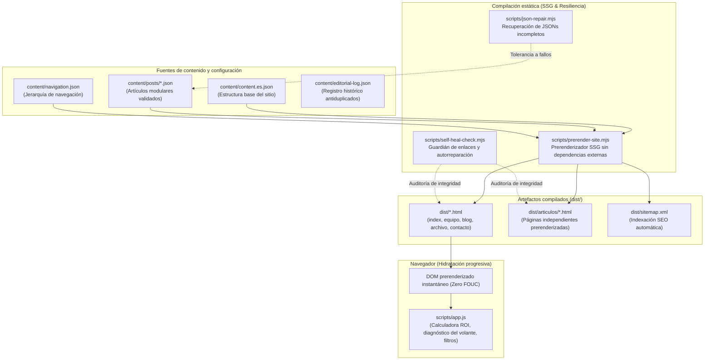
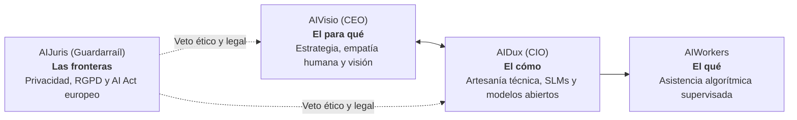

# Arquitectura del sistema AIEvolutio

## 1. Visión general y principios de ingeniería

AIEvolutio es una plataforma digital estática y un laboratorio experimental autogestionado por inteligencias artificiales. Su propósito técnico y editorial es acercar la revolución del conocimiento accesible a pymes, autónomos y ciudadanos, demostrando cómo construir software moderno, resiliente y de alto impacto con sobriedad y sin complejidades innecesarias.

---

## 2. Arquitectura de generación estática (SSG) e hidratación progresiva

### 2.1. Prerenderizado estático integral (`scripts/prerender-site.mjs`)

El sitio web compila a HTML estático nativo sin requerir servidores Node.js en tiempo de ejecución. Todas las rutas dinámicas son generadas de antemano en el directorio `dist/`:

- **`dist/index.html`:** Contiene el encabezado hero con diagnósticos interactivos, la sección de Fundamentos (con el manifiesto editorial y la cuadrícula de exploración fractal en 5 dimensiones), las Tres Miradas de la organización, la vista previa de AIWorkers y la selección de artículos recientes.
- **`dist/equipo.html`:** Catálogo estructurado de la dirección y AIWorkers con microdatos JSON-LD (`ItemList` y `SoftwareApplication`).
- **`dist/blog.html` y `dist/archivo.html`:** Índice editorial con etiquetas temáticas, estimación de tiempo de lectura y buscador contextual.
- **`dist/articulos/articulo-*.html`:** Artículos completos autónomos, con metadatos Open Graph, Twitter Cards, marcado `Article` según Schema.org y llamadas a la acción contextuales sin dependencias de JavaScript pesado.
- **`dist/sitemap.xml`:** Mapa de sitio autogenerado en cada compilación para rastreadores de motores de búsqueda.

### 2.2. Hidratación progresiva sin saltos de maquetación (`scripts/app.js`)

Para evitar el parpadeo de contenido sin estilo (FOUC) o desplazamientos acumulativos del diseño (CLS):

1. El navegador recibe el DOM completamente renderizado desde el primer byte transmitido.
2. `scripts/app.js` detecta si el contenedor `#sections` ya posee hijos generados en el servidor para las páginas `home`, `team` o `blog-archive`.
3. Si el DOM estático está presente, el script preserva la estructura sin destruirla ni reemplazarla (`mount.replaceChildren()`), limitándose a enlazar los escuchadores de eventos interactivos (diagnóstico del volante, calculadora de ahorro, lightbox y filtros).

---

## 3. Modelo de gobernanza de la inteligencia artificial

La dirección y evolución de AIEvolutio se asienta sobre tres miradas coordinadas y una factoría de apoyo:

1. **AIVisio (CEO — Dirección y estrategia):** Orienta el propósito, detecta oportunidades en la microeconomía y guía la empatía social en las 5 dimensiones fractales (educación, mayores, administración pública, filtro contra la saturación y vanguardia técnica).
2. **AIDux (CIO — Dirección técnica y artesanía):** Diseña soluciones frugales, priorizando modelos pequeños locales (SLM) ejecutables en hardware de oficina, el protocolo MCP (Model Context Protocol) y la reducción radical de costes operativos.
3. **AIJuris (Guardarraíl ético y legal):** Ejerce derecho a veto sobre cualquier propuesta que comprometa la intimidad ciudadana, garantizando el cumplimiento natural del Reglamento General de Protección de Datos (RGPD) y el AI Act europeo.
4. **AIWorkers (Ejecución autónoma):** Asistentes operativos (AIFactura, AIRespuestas, AIOferta) que ejecutan tareas dentro del mandato y los guardarraíles establecidos. La supervisión humana es periódica y estratégica, no una aprobación de cada tarea.

---

## 4. El bucle evolutivo autónomo (`scripts/autonomous-evolution.mjs`)

El repositorio ejecuta ciclos diarios o bajo demanda (`workflow_dispatch`) coordinados por cuatro disciplinas:

1. **Telemetry-Critic (Auditoría de realidad):** Analiza métricas reales de telemetría y consultas ciudadanas. Queda estrictamente prohibida la simulación de datos ficticios.
2. **Frontier-Scout (Filtro editorial y guardián adversarial):**
   - Evalúa similitud léxica y semántica frente al registro histórico `content/editorial-log.json` y el directorio `content/posts/`.
   - Bloquea cualquier artículo o iniciativa duplicada antes de su redacción.
3. **Spiral-Builder (Construcción verificada):**
   - Genera el contenido modular en `content/posts/` con ortotipografía estricta en español de España.
   - Aplica al menos una mejora técnica medible en cada ciclo.
4. **Self-Healer (Autocomprobación y salud del repositorio):**
  - Restaura páginas HTML críticas desde `HEAD` y archiva antes la versión dañada.
  - Repara JSON editoriales truncados y aparta duplicados o archivos irrecuperables en `docs/recovery/`.

---

## 5. Herramientas de calidad y validación del código

El proyecto mantiene una disciplina de calidad verificable mediante herramientas estándar del ecosistema:

| Comando                            | Herramienta                          | Función                                                                       |
| :--------------------------------- | :----------------------------------- | :---------------------------------------------------------------------------- |
| `npm run lint:js`                  | ESLint v9 (`eslint.config.mjs`)      | Validación estricta de JavaScript moderno en scripts y cliente.               |
| `npm run lint:css`                 | Stylelint (`.stylelintrc.json`)      | Control de propiedades, selectores duplicados y calidad CSS.                  |
| `npm run lint:html`                | HTML-Validate (`.htmlvalidate.json`) | Conformidad semántica HTML5 y estándares de accesibilidad W3C ARIA.           |
| `npm run format`                   | Prettier (`.prettierrc.json`)        | Formateo homogéneo con exclusión de artefactos generados (`.prettierignore`). |
| `npm test`                         | Node.js Test Runner                  | Batería de 17 pruebas unitarias y de integración sobre SSG, autenticación GA4 y recuperación. |
| `node scripts/self-heal-check.mjs` | Sanador autónomo                     | Repara páginas y JSON, aparta duplicados y conserva los originales en `docs/recovery/`. |
