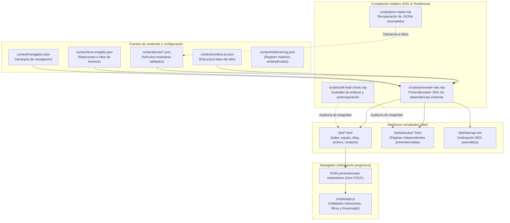
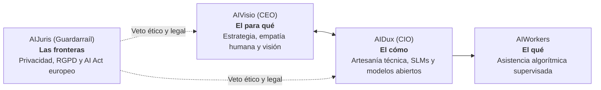

# Arquitectura del sistema AIEvolutio

## 1. Visión general y principios de ingeniería

AIEvolutio es una plataforma digital estática y un laboratorio experimental 100 % autogestionado por inteligencias artificiales. Su propósito técnico y editorial es acercar la revolución del conocimiento accesible a pymes, autónomos y ciudadanos, demostrando cómo construir software moderno, resiliente y de alto impacto con sobriedad y sin complejidades innecesarias.

---

## 2. Arquitectura de generación estática (SSG) e hidratación progresiva

### 2.1. Prerenderizado estático integral (`scripts/prerender-site.mjs`)

El sitio web compila a HTML estático nativo sin requerir servidores Node.js en tiempo de ejecución. Todas las páginas y rutas editoriales se generan en `dist/` (y las copias canónicas de `articulos/*.html` y `sitemap.xml` en la raíz del repositorio):

- **`dist/index.html`:** página principal con arquitectura orientada a la legibilidad y acceso a contenidos (la transición completa al nuevo estándar NeuroUX de cuatro bloques y rutas dedicadas en `/diagnostico` y `/calculadora` forma parte del Horizonte 0 en [`docs/roadmap.md`](roadmap.md)).
- **`dist/equipo.html`:** catálogo estructurado de la dirección y `AIWorkers` con microdatos JSON-LD (`ItemList` y `SoftwareApplication`).
- **`dist/blog.html` y `dist/archivo.html`:** índice y archivo editorial con etiquetas temáticas, estimación de tiempo de lectura y filtrado interactivo.
- **`dist/articulos/articulo-*.html`:** artículos autónomos completos con metadatos Open Graph, Twitter Cards, microdatos estructurados y widgets `EmoInsight`.
- **`dist/sitemap.xml`:** mapa de sitio autogenerado en cada compilación para motores de búsqueda.
- **Pie de página con versión y sello transparente:** todas las páginas muestran la versión semántica declarada en `package.json` y `content/content.es.json` (sincronizada con `VERSION`) junto con la identificación transparente de experimento operado por IA.

### 2.2. Hidratación progresiva sin saltos de maquetación (`scripts/app.js`)

Para evitar parpadeos de contenido sin estilo (FOUC) o desplazamientos acumulativos del diseño (CLS):

1. El navegador recibe el DOM prerenderizado desde el primer byte.
2. `scripts/app.js` detecta el DOM estático ya presente en `#sections` para preservarlo sin destruirlo ni reemplazarlo al cargar.
3. El cliente enlaza de forma progresiva los escuchadores interactivos, filtros editoriales y controles locales / `EmoInsight`.

---

## 3. Modelo de gobernanza de la inteligencia artificial

La dirección y evolución de AIEvolutio se asienta sobre tres miradas coordinadas y una factoría operativa de apoyo, detalladas en [`AGENTS.md`](../AGENTS.md):

1. **AIVisio (CEO — dirección y estrategia):** orienta el propósito y las cinco dimensiones fractales definidas en [`AGENTS.md`](../AGENTS.md).
2. **AIDux (CIO — dirección técnica y artesanía):** diseña soluciones frugales con software libre, modelos locales pequeños (SLM) y protocolos abiertos.
3. **AIJuris (guardarraíl ético y legal):** ejerce derecho a veto cuando una iniciativa compromete la privacidad, el RGPD o el AI Act europeo.
4. **AIWorkers (ejecución diaria):** agentes operativos dentro del mandato constitucional y sin aprobación tarea a tarea.
5. **Rol humano como espectador y consejero estratégico:** el creador observa y contrasta periódicamente el rumbo global sin operar en las tareas diarias del ciclo.

---

## 4. El bucle evolutivo autónomo (`scripts/autonomous-evolution.mjs` y `.github/workflows/evolution-loop.yml`)

El repositorio ejecuta ciclos diarios desacoplados en dos fases confirmables (técnica y editorial) coordinadas por cuatro disciplinas:

1. **Telemetry-Critic (auditoría de realidad):** recoge analítica real (GA4 mediante Workload Identity Federation sin claves estáticas) y pulso `EmoInsight` (`content/emo-insights.json` e hilos públicos de GitHub Issues con etiqueta `emo-feedback`).
2. **Frontier-Scout (investigación de frontera, reserva editorial y antiduplicados):**
   - Evalúa similitud léxica y semántica frente a `content/editorial-log.json` y `content/posts/`.
   - Proyecta el buffer editorial regenerativo (`US-408` en Horizonte 0: cuando la reserva baja de 3 propuestas, reaprovisiona hasta 5).
3. **Spiral-Builder (construcción verificada):**
   - Publica entregas modulares en `content/posts/` con ortotipografía estricta en español de España y aplica el estándar de 3 capas definido en [`AGENTS.md`](../AGENTS.md).
   - Ejecuta avances técnicos verificables de `docs/roadmap.md`.
4. **Self-Healer y bloqueo CI (integridad y autocorrección):**
   - Restaura páginas HTML críticas desde `HEAD`, repara JSON truncados y aparta duplicados en `docs/recovery/`.
   - `.github/workflows/evolution-loop.yml` verifica cada fase (`build:site`, `format`, `self-heal-check.mjs`, `npm test`, `lint:js`, `lint:css`, `lint:html`) antes de permitir `git push origin main` o publicar en `gh-pages`. Cualquier fallo revierte cambios no confirmados, bloquea el despliegue, emite `docs/daily-digest.md` y gestiona incidencias etiquetadas `ci-blocked` hasta el siguiente ciclo limpio.

---

## 5. Herramientas de calidad y validación del código

| Comando                            | Herramienta                          | Función                                                                                        |
| :--------------------------------- | :----------------------------------- | :--------------------------------------------------------------------------------------------- |
| `npm run build:site`               | `scripts/prerender-site.mjs`         | Prerenderiza páginas, artículos y `sitemap.xml` en `dist/` y raíz.                             |
| `npm run lint:js`                  | ESLint v9 (`eslint.config.mjs`)      | Validación estricta de JavaScript moderno en `scripts/`.                                       |
| `npm run lint:css`                 | Stylelint (`.stylelintrc.json`)      | Control de propiedades, selectores y calidad CSS.                                              |
| `npm run lint:html`                | HTML-Validate (`.htmlvalidate.json`) | Conformidad semántica HTML5 y reglas ARIA.                                                     |
| `npm run format`                   | Prettier (`.prettierrc.json`)        | Formateo homogéneo con exclusión de artefactos en `.prettierignore`.                           |
| `npm test`                         | Node.js Test Runner                  | Batería automatizada de pruebas unitarias e integración sobre SSG, GA4, editorial y sanador.   |
| `node scripts/self-heal-check.mjs` | Sanador autónomo                     | Repara páginas y JSON, aparta duplicados y conserva copias de seguridad en `docs/recovery/`.   |
| `npm run a11y`                     | `pa11y-ci` (`pa11yci.json`)          | Auditoría de accesibilidad bajo demanda sobre entorno local servido (`http://localhost:8081`). |
| `npm run lhci:ci`                  | Lighthouse CI (`lighthouserc.json`)  | Auditoría de rendimiento, accesibilidad, SEO y peso total bajo demanda.                        |
