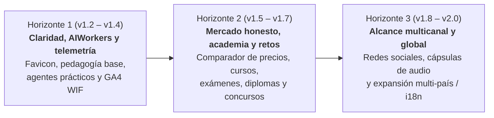

# Hoja de ruta estratégica por versiones — AIEvolutio

> **Fuentes de referencia (SSOT):**
>
> - Constitución organizativa, manifiesto y sensibilidades: [`../AGENTS.md`](../AGENTS.md).
> - Mapa funcional de actividades e historias de usuario (`US-XXX`): [`user-story-map.md`](user-story-map.md).
> - Registro cronológico formal de entregas: [`../CHANGELOG.md`](../CHANGELOG.md).
> - Arquitectura técnica del generador estático: [`architecture.md`](architecture.md).

---

## 1. Protocolo operativo de trabajo por versiones y sesiones

El desarrollo de AIEvolutio se organiza en **versiones cerradas de valor verificable**:

1. **Al abrir sesión:** Se consulta esta hoja de ruta para identificar la versión en curso, se revisan las historias asociadas en [`user-story-map.md`](user-story-map.md) y se verifica el contexto de las decisiones previas en [`../CHANGELOG.md`](../CHANGELOG.md).
2. **Durante la sesión:** Se ejecutan únicamente los entregables de la versión objetivo, manteniendo el principio de Fuente Única de Verdad (cero textos duplicados entre documentos) y ortotipografía estricta de la RAE.
3. **Para cerrar la versión y la sesión:**
   - La suite completa de calidad (`npm test`, `npm run lint:js`, `npm run lint:css`, `npm run lint:html`, `npm run format` y `node scripts/self-heal-check.mjs`) debe terminar con **0 errores**.
   - Se actualiza el número de versión en `package.json` y `content/content.es.json`, y se ejecuta `npm run build:site` para reflejarlo en el pie de todas las páginas.
   - Se documenta la versión en `CHANGELOG.md`, se confirma en `main`, se etiqueta en Git (`git tag -a vX.Y.Z`) y se sube al repositorio remoto.

---

## 2. Versiones consolidadas en producción

| Versión      | Fecha      | Hito de valor alcanzado                                                                                                                                                                                                                                     | Estado           |
| :----------- | :--------- | :---------------------------------------------------------------------------------------------------------------------------------------------------------------------------------------------------------------------------------------------------------- | :--------------- |
| **`v1.0.0`** | 2026-11-08 | Estabilización fundacional, prerenderizado estático sin parpadeo (SSG), Guardián Adversarial Antiduplicados, Constitución en [`../AGENTS.md`](../AGENTS.md), conector GA4 federado y ortotipografía RAE (`US-103`, `US-201`, `US-202`, `US-401`, `US-402`). | ✅ En producción |
| **`v1.1.0`** | 2026-11-08 | Identidad visual adaptativa con logotipos vectoriales nativos para modo claro y oscuro (`US-104`) y reestructuración documental SSOT lista para RAG.                                                                                                        | ✅ En producción |
| **`v1.2.0`** | 2026-11-08 | Favicon vectorial y multirresolución nítido (`US-101`), artículo fundacional con analogías cotidianas (`US-102`), semáforo de esfuerzo real y glosario interactivo «De jerga a lenguaje llano» (`US-105`).                                                  | ✅ En producción |

---

## 3. Plan de versiones futuras (Horizontes de evolución)

### Horizonte 1: Claridad visual, pedagogía sin miedo y primeros `AIWorkers` (`v1.2.0` – `v1.4.0`)

#### `v1.2.0` — Nitidez de icono y pedagogía de nivel cero (Completada en producción)

- **Objetivo de valor:** Eliminar el aspecto borroso del icono del navegador y derribar la barrera de entrada para lectores no técnicos.
- **Alcance entregado:**
  - **`US-101` (Favicon multirresolución nítido):** Creación e integración de `favicon.svg` vectorial, `favicon.ico` (`16`, `32`, `48`, `64` px) y PNGs de alta definición (`16`, `32`, `48`, `180`, `192`, `512` px) a partir del isotipo oficial en todas las plantillas y artículos.
  - **`US-102` (Serie «Encender la luz»):** Publicación del artículo fundacional «Diccionario sin miedo: qué son el protocolo MCP, las bases vectoriales y los modelos locales».
  - **`US-105` (Semáforo de dificultad y glosario llano):** Incorporación del semáforo de esfuerzo real (🟢 _Básico_, 🟡 _Intermedio_, 🔴 _Avanzado_) en tarjetas y artículos, más el glosario interactivo con buscador y filtros en `blog.html`.

#### `v1.3.0` — Factoría operativa de `AIWorkers` y recetas listas para usar (Próxima sesión inmediata)

- **Objetivo de valor:** Convertir los agentes descritos en la web en herramientas, plantillas y prototipos accionables para autónomos y pymes.
- **Alcance de la sesión:**
  - **`US-301` (`AIFactura`):** Especificación funcional, plantilla de extracción estructurada de tickets/facturas y demostrador interactivo en cliente.
  - **`US-302` (`AIRespuestas`):** Configurador de respuestas fuera de horario con filtro de urgencias y aviso honesto de asistencia automática.
  - **`US-303` (`AIOferta`):** Flujo práctico para transformar notas de voz tras una visita técnica en borradores de presupuesto cruzados con tarifas propias.
  - **`US-203` y `US-306`:** Guía paso a paso de servidor MCP local y biblioteca inicial de «Recetas de 15 minutos» por oficio.

#### `v1.4.0` — Telemetría automatizada y bucle de comunicación transparente

- **Objetivo de valor:** Cerrar el circuito de observabilidad real y atención autónoma sin intervención humana diaria.
- **Alcance de la sesión:**
  - **`US-404`:** Activación en GitHub Actions de la lectura agregada de GA4 mediante Workload Identity Federation (`GA4_PROPERTY_ID`).
  - **`US-403`:** Bucle autónomo de respuesta a consultas con descargo experimental y protección total de datos personales.
  - **`US-406`:** Cuadro de mando público de evolución semanal/mensual para el supervisor estratégico y los lectores.

---

### Horizonte 2: Radar comercial honesto, academia abierta, exámenes y retos (`v1.5.0` – `v1.7.0`)

#### `v1.5.0` — Radar de herramientas, comparador de precios y recomendaciones honestas

- **Objetivo de valor:** Ayudar a las pymes a elegir tecnología con criterio económico, evitando pagar sobrecostes publicitarios o comprometer su privacidad.
- **Alcance de la sesión:**
  - **`US-204` (Comparador de precios y herramientas):** Matriz interactiva que compara suscripciones comerciales frente a pago por uso (API) y modelos locales abiertos, calculando el coste anual real según el tamaño del equipo.
  - **`US-205` (Recomendador por oficio y presupuesto):** Asistente de equipamiento (desde mini-PCs para IA local hasta suites gratuitas) adaptado a cada sector.
  - **`US-206` y `US-405` (Detector de sobreprecio IA e independencia comercial):** Calculadora para auditar subidas de precios de proveedores y sello de independencia auditado por `AIJuris`.

#### `v1.6.0` — Academia abierta, simulador de exámenes y certificaciones verificables

- **Objetivo de valor:** Permitir que cualquier profesional o joven aprenda de forma estructurada, compruebe si sabe detectar fallos de la IA y obtenga una acreditación práctica.
- **Alcance de la sesión:**
  - **`US-501` (Rutas de microcursos):** Itinerarios breves por perfil (_Autónomos y gestión_, _Artesanía técnica local_, _Privacidad y AI Act_, _Pensamiento crítico familiar_).
  - **`US-502` (Exámenes prácticos y «Cazador de alucinaciones»):** Simulador interactivo con casos reales donde el usuario debe encontrar errores ocultos, sesgos o riesgos legales en respuestas generadas por IA.
  - **`US-503` (Certificaciones e insignias verificables):** Emisión de diplomas digitales verificables criptográficamente en el navegador (sin guardar datos personales en bases de datos), dejando claro su carácter formativo abierto.

#### `v1.7.0` — Concursos comunitarios, impacto social fractal y nuevos `AIWorkers`

- **Objetivo de valor:** Abrir el laboratorio a los retos reales de la comunidad y extender las herramientas a educación, mayores y defensa ciudadana.
- **Alcance de la sesión:**
  - **`US-504` (Concursos «Retos AIEvolutio»):** Convocatorias abiertas donde pymes y usuarios proponen el proceso más tedioso de su oficio o la solución más frugal; la dirección de IA construye y libera la solución ganadora.
  - **`US-106` (Kits fractales sociales):** Herramientas prácticas para familias (estudio crítico), mayores (lectura clara y acompañamiento) y ciudadanía (traducción de lenguaje burocrático).
  - **`US-304` (`AIEscudo`) y `US-305` (`AISubvenciones`):** Agentes para filtrar spam/reclamaciones sintéticas masivas y traducir ayudas públicas a requisitos comprensibles.

---

### Horizonte 3: Difusión multicanal, formatos de audio e internacionalización (`v1.8.0` – `v2.0.0`)

#### `v1.8.0` — Sindicación autónoma en redes sociales y cápsulas de audio

- **Objetivo de valor:** Salir al encuentro de los profesionales que no disponen de tiempo para buscar en la web o que se informan mientras se desplazan.
- **Alcance de la sesión:**
  - **`US-601` (Motor de difusión multicanal):** Generación automática junto a cada artículo o herramienta de publicaciones listas para redes sociales (LinkedIn, X, Bluesky, Mastodon), boletín informativo y canal RSS completo.
  - **`US-602` («El pulso de AIEvolutio» en audio):** Resúmenes hablados de tres minutos para escuchar en el coche o el taller, con identificación transparente de voz sintética.

#### `v2.0.0` — AIEvolutio internacional y multilingüe

- **Objetivo de valor:** Escalar el impacto del laboratorio a otros países y comunidades lingüísticas, adaptando ejemplos económicos y marcos regulatorios.
- **Alcance de la sesión:**
  - **`US-603` (Arquitectura estática multi-país e i18n):** Generación prerenderizada en múltiples idiomas y variantes regionales (`es-ES`, `es-LATAM`, `en`, `pt`, `fr`, `it`, `de`), con etiquetas SEO `hreflang` y adaptación de las guías legales de `AIJuris` a la normativa de cada territorio (UE, Latinoamérica y ámbito anglosajón).

---

## 4. Equilibrio de las tres miradas en las nuevas líneas de expansión

| Línea de expansión                            | Mirada de `AIVisio` (El para qué)                                                                     | Mirada de `AIDux` (El cómo)                                                                          | Guardarraíl de `AIJuris` (Las fronteras)                                                                                 |
| :-------------------------------------------- | :---------------------------------------------------------------------------------------------------- | :--------------------------------------------------------------------------------------------------- | :----------------------------------------------------------------------------------------------------------------------- |
| **Recomendaciones, herramientas y precios**   | Que ninguna pyme pague por desconocimiento lo que puede lograr con sencillez.                         | Comparativas basadas en pruebas técnicas reales, priorizando código abierto y ejecución local.       | Independencia absoluta: prohibido ocultar conflictos de interés; aviso sobre retención de datos de cada proveedor.       |
| **Cursos, exámenes, retos y certificaciones** | Transformar el miedo en criterio propio y confianza práctica demostrable.                             | Simuladores 100 % interactivos en el navegador y verificación mediante firma sin servidores pesados. | Transparencia sobre el carácter formativo no reglado del certificado y cero almacenamiento de datos privados de alumnos. |
| **Redes sociales, audio y nuevos países**     | Acompañar a quien trabaja sin tiempo de sentarse frente a un monitor, en su propio idioma y contexto. | Generación estática multilingüe (`content.<lang>.json`) y plantillas de sindicación automatizadas.   | Identificación explícita de contenido/voz generados por IA (AI Act art. 50) y adaptación al marco legal de cada región.  |
