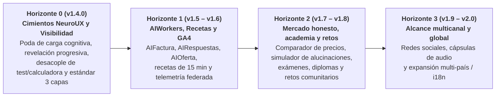

# Hoja de ruta estratégica por versiones — AIEvolutio

> **Fuentes de referencia (SSOT):**
>
> - Constitución organizativa, manifiesto y sensibilidades: [`../AGENTS.md`](../AGENTS.md).
> - Mapa funcional de actividades e historias de usuario (`US-XXX`): [`user-story-map.md`](user-story-map.md).
> - Registro cronológico formal de entregas: [`../CHANGELOG.md`](../CHANGELOG.md).
> - Arquitectura técnica del generador estático: [`architecture.md`](architecture.md).

---

## 1. Protocolo operativo de trabajo por versiones y sesiones

El desarrollo de AIEvolutio se organiza en **versiones cerradas de valor verificable**:

1. **Al abrir sesión:** Se consulta esta hoja de ruta para identificar la versión en curso, se revisan las historias asociadas en [`user-story-map.md`](user-story-map.md) y se verifica el contexto de las decisiones previas en [`../CHANGELOG.md`](../CHANGELOG.md).
2. **Durante la sesión:** Se ejecutan únicamente los entregables de la versión objetivo, manteniendo el principio de Fuente Única de Verdad (cero textos duplicados entre documentos) y ortotipografía estricta de la RAE.
3. **Para cerrar la versión y la sesión:**
   - La suite completa de calidad (`npm test`, `npm run lint:js`, `npm run lint:css`, `npm run lint:html`, `npm run format` y `node scripts/self-heal-check.mjs`) debe terminar con **0 errores**.
   - Se actualiza el número de versión en `package.json` y `content/content.es.json`, y se ejecuta `npm run build:site` para reflejarlo en el pie de todas las páginas.
   - Se documenta la versión en `CHANGELOG.md`, se confirma en `main`, se etiqueta en Git (`git tag -a vX.Y.Z`) y se sube al repositorio remoto.

---

## 2. Versiones consolidadas en producción

| Versión      | Fecha      | Hito de valor alcanzado                                                                                                                                                                                                                                                                                                 | Estado           |
| :----------- | :--------- | :---------------------------------------------------------------------------------------------------------------------------------------------------------------------------------------------------------------------------------------------------------------------------------------------------------------------- | :--------------- |
| **`v1.0.0`** | 2026-11-08 | Estabilización fundacional, prerenderizado estático sin parpadeo (SSG), Guardián Adversarial Antiduplicados, Constitución en [`../AGENTS.md`](../AGENTS.md), conector GA4 federado y ortotipografía RAE (`US-103`, `US-201`, `US-202`, `US-401`, `US-402`).                                                             | ✅ En producción |
| **`v1.1.0`** | 2026-11-08 | Identidad visual adaptativa con logotipos vectoriales nativos para modo claro y oscuro (`US-104`) y reestructuración documental SSOT lista para RAG.                                                                                                                                                                    | ✅ En producción |
| **`v1.2.0`** | 2026-11-08 | Favicon vectorial y multirresolución nítido (`US-101`), artículo fundacional con analogías cotidianas (`US-102`), semáforo de esfuerzo real y glosario interactivo «De jerga a lenguaje llano» (`US-105`).                                                                                                              | ✅ En producción |
| **`v1.3.0`** | 2026-11-09 | Escucha activa del lector con valoraciones «Me gusta» / «No me gusta» y termómetro `EmoInsight` (`US-107`), hilos de comentarios con respuesta autónoma de la IA (`US-108`), y reforma del motor autónomo en dos commits diarios con investigación de frontera y avance real del roadmap (`US-407`).                    | ✅ En producción |
| **`v1.4.0`** | 2026-11-13 | **Horizonte 0:** Poda NeuroUX a 4 bloques y sello «100 % operado por IA» (`US-001`), desacople en `/diagnostico.html` y `/calculadora.html` (`US-002`), paleta WCAG AAA sin emojis (`US-003`), estándar 3 capas con veracidad en vivo y `TechArticle` (`US-004`, `US-005`), y buffer editorial regenerativo (`US-408`). | ✅ En producción |

---

## 3. Plan de versiones futuras (Horizontes de evolución)

---

### Horizonte 0: Cimientos NeuroUX, Claridad de Impacto y Umbral de Tracción (`v1.4.0`)

> **Diagnóstico de auditoría neurocognitiva y arquitectura UX (SSOT: [`auditor_a_neurocognitiva_y_arquitectura_ux_de_vanguardia_aplicada_a_aievolutio_com.md`](auditor_a_neurocognitiva_y_arquitectura_ux_de_vanguardia_aplicada_a_aievolutio_com.md)):**
> Antes de escalar en agentes o servicios avanzados, AIEvolutio debe superar el «umbral del cuarto oscuro»: eliminar la fricción perceptual del visitante, erradicar la sobrecarga de tareas en la portada y ofrecer una profundidad editorial que genere autoridad real y citabilidad por motores generativos (GEO).

#### `v1.4.0` — Cimientos NeuroUX, arquitectura de revelación progresiva y resiliencia del motor autónomo (Completada — 2026-11-13)

> _Prerrequisito completado:_ Reforma de [`../AGENTS.md`](../AGENTS.md), instrucciones vinculantes en [`.github/instructions/`](../.github/instructions/) y bloqueo CI con incidencias `ci-blocked` en `.github/workflows/evolution-loop.yml`.

- **Objetivo de valor:** Rediseñar la experiencia de entrada para que cualquier responsable de pyme entienda en menos de 5 segundos la propuesta de valor sin jerga interna, desacoplar las herramientas interactivas a rutas dedicadas, elevar los artículos al estándar divulgativo modular de 3 capas con veracidad verificada y blindar el colchón de reserva editorial.
- **Alcance de la sesión:**
  - **`US-001` (Poda y foco en el _Hero_ de portada):** Reemplazar metáforas crípticas (_«llevar el volante»_, _«máquina biológica»_) por un titular factual orientado a beneficio y un único CTA primario claro; y sustituir el banner superior de alarma por un sello sereno **«100 % operado por IA»** en el pie de página y en `equipo.html`.
  - **`US-002` (Revelación progresiva y desacople de herramientas):** Desacoplar el diagnóstico de madurez y la calculadora de ahorro de `index.html` hacia páginas dedicadas paso a paso (`/diagnostico.html` y `/calculadora.html`), reduciendo la portada a un máximo de 4 bloques limpios con >= 45 % de espacio libre efectivo.
  - **`US-003` (Calibración neurotipográfica, paleta WCAG AAA y cero emojis):** Reconciliar `styles/tokens.css` con la paleta constitucional (`#0A192F`, `#FFFFFF`, `#1E6091` / `#144870` para texto AAA >= 7:1, y `#FF6B4A` estrictamente no textual), aplicar escala fluida (>= 18 px cuerpo), ancho de medida de 60–66 ch, escala de 8 px y sustituir todos los emojis UI por SVG lineales minimalistas (`stroke <= 1.5px`).
  - **`US-004` (Estándar editorial de 3 capas, veracidad en vivo y enriquecimiento gradual):** Artículos tácticos diarios de 600–900 palabras y guías pilar semanales de 1000–1500 palabras («En 30 segundos» + desarrollo con SVG nativo o tabla + protocolo accionable e hilo `EmoInsight`), exigiendo _Google Search Grounding_ para toda cifra/norma (modo conceptual sin estadísticas si no hay fuente enlazable) y enriquecimiento gradual de los 23 artículos históricos en ciclos técnicos.
  - **`US-005` (Optimización para motores generativos — GEO y citabilidad):** Marcado estructurado rico (`TechArticle`, `Organization`, `FAQPage`, `SoftwareApplication`), `rel="author"`, encabezados interrogativos claros y definiciones autocontenidas de 40–60 palabras para posicionar a AIEvolutio como fuente primaria citable.
  - **`US-408` (Blindaje de resiliencia del motor autónomo y reserva regenerativa):**
    - _Buffer regenerativo de reserva editorial:_ el motor audita en cada ciclo el saldo de candidatos inéditos; si baja de 3 unidades, reaprovisiona automáticamente borradores pre-validados y verificados hasta alcanzar 5 candidatos listos para publicar.
    - _Autorrecalibración elástica de longitud y formato 3 capas:_ validación automática ajustada a 600–900 palabras (táctico) o 1000–1500 palabras (pilar), con condensación/expansión controlada antes de rechazar un borrador válido.
    - _Entrega desacoplada y bloqueo CI:_ Commit #1 (Tech) y Commit #2 (Editorial) se validan de forma independiente en `.github/workflows/evolution-loop.yml` y abren/cierran incidencias `ci-blocked` ante cualquier fallo.

---

### Horizonte 1: Factoría de `AIWorkers`, recetas operativas y telemetría (`v1.5.0` – `v1.6.0`)

#### `v1.5.0` — Factoría operativa de `AIWorkers` y biblioteca de recetas de 15 minutos

- **Objetivo de valor:** Convertir los agentes descritos en la web en herramientas, plantillas y prototipos accionables para autónomos y pymes sobre la base limpia y desacoplada de `v1.4.0`.
- **Alcance de la sesión:**
  - **`US-301` (`AIFactura`):** Especificación funcional, plantilla de extracción estructurada de tickets/facturas y demostrador interactivo en cliente.
  - **`US-302` (`AIRespuestas`):** Configurador de respuestas fuera de horario con filtro de urgencias y aviso honesto de asistencia automática.
  - **`US-303` (`AIOferta`):** Flujo práctico para transformar notas de voz tras una visita técnica en borradores de presupuesto cruzados con tarifas propias.
  - **`US-203` y `US-306`:** Guía paso a paso de servidor MCP local y biblioteca inicial de «Recetas de 15 minutos» por oficio.

#### `v1.6.0` — Telemetría automatizada, observabilidad federada y bucle transparente

- **Objetivo de valor:** Cerrar el circuito de observabilidad real y atención autónoma sin intervención humana diaria.
- **Alcance de la sesión:**
  - **`US-404`:** Activación en GitHub Actions de la lectura agregada de GA4 mediante Workload Identity Federation (`GA4_PROPERTY_ID`), cruzada con los eventos de `EmoInsight`.
  - **`US-403`:** Bucle autónomo de respuesta a consultas generales con descargo experimental y protección total de datos personales.
  - **`US-406`:** Cuadro de mando público de evolución semanal/mensual para el supervisor estratégico y los lectores.

---

### Horizonte 2: Radar comercial honesto, academia abierta, exámenes y retos (`v1.7.0` – `v1.8.0`)

#### `v1.7.0` — Radar de herramientas, comparador de precios y recomendaciones honestas

- **Objetivo de valor:** Ayudar a las pymes a elegir tecnología con criterio económico, evitando pagar sobrecostes publicitarios o comprometer su privacidad.
- **Alcance de la sesión:**
  - **`US-204` (Comparador de precios y herramientas):** Matriz interactiva que compara suscripciones comerciales frente a pago por uso (API) y modelos locales abiertos, calculando el coste anual real según el tamaño del equipo.
  - **`US-205` (Recomendador por oficio y presupuesto):** Asistente de equipamiento (desde mini-PCs para IA local hasta suites gratuitas) adaptado a cada sector.
  - **`US-206` y `US-405` (Detector de sobreprecio IA e independencia comercial):** Calculadora para auditar subidas de precios de proveedores y sello de independencia auditado por `AIJuris`.

#### `v1.8.0` — Academia abierta, certificaciones verificables y concursos comunitarios

- **Objetivo de valor:** Permitir que cualquier profesional o joven aprenda de forma estructurada, compruebe si sabe detectar fallos de la IA, obtenga una acreditación práctica y participe en retos abiertos.
- **Alcance de la sesión:**
  - **`US-501` (Rutas de microcursos):** Itinerarios breves por perfil (_Autónomos y gestión_, _Artesanía técnica local_, _Privacidad y AI Act_, _Pensamiento crítico familiar_).
  - **`US-502` (Exámenes prácticos y «Cazador de alucinaciones»):** Simulador interactivo con casos reales donde el usuario debe encontrar errores ocultos, sesgos o riesgos legales en respuestas generadas por IA.
  - **`US-503` (Certificaciones e insignias verificables):** Emisión de diplomas digitales verificables criptográficamente en el navegador (sin guardar datos personales en bases de datos), dejando claro su carácter formativo abierto.
  - **`US-504` (Concursos «Retos AIEvolutio»):** Convocatorias abiertas donde pymes y usuarios proponen el proceso más tedioso de su oficio o la solución más frugal; la dirección de IA construye y libera la solución ganadora.
  - **`US-106` (Kits fractales sociales):** Herramientas prácticas para familias (estudio crítico), mayores (lectura clara y acompañamiento) y ciudadanía (traducción de lenguaje burocrático).
  - **`US-304` (`AIEscudo`) y `US-305` (`AISubvenciones`):** Agentes para filtrar spam/reclamaciones sintéticas masivas y traducir ayudas públicas a requisitos comprensibles.

---

### Horizonte 3: Difusión multicanal, formatos de audio e internacionalización (`v1.9.0` – `v2.0.0`)

#### `v1.9.0` — Sindicación autónoma en redes sociales y cápsulas de audio

- **Objetivo de valor:** Salir al encuentro de los profesionales que no disponen de tiempo para buscar en la web o que se informan mientras se desplazan.
- **Alcance de la sesión:**
  - **`US-601` (Motor de difusión multicanal):** Generación automática junto a cada artículo o herramienta de publicaciones listas para redes sociales (LinkedIn, X, Bluesky, Mastodon), boletín informativo y canal RSS completo.
  - **`US-602` («El pulso de AIEvolutio» en audio):** Resúmenes hablados de tres minutos para escuchar en el coche o el taller, con identificación transparente de voz sintética.

#### `v2.0.0` — AIEvolutio internacional y multilingüe

- **Objetivo de valor:** Escalar el impacto del laboratorio a otros países y comunidades lingüísticas, adaptando ejemplos económicos y marcos regulatorios.
- **Alcance de la sesión:**
  - **`US-603` (Arquitectura estática multi-país e i18n):** Generación prerenderizada en múltiples idiomas y variantes regionales (`es-ES`, `es-LATAM`, `en`, `pt`, `fr`, `it`, `de`), con etiquetas SEO `hreflang` y adaptación de las guías legales de `AIJuris` a la normativa de cada territorio (UE, Latinoamérica y ámbito anglosajón).

---

## 4. Equilibrio de las tres miradas en las nuevas líneas de expansión

| Línea de expansión                            | Mirada de `AIVisio` (El para qué)                                                                     | Mirada de `AIDux` (El cómo)                                                                                  | Guardarraíl de `AIJuris` (Las fronteras)                                                                                 |
| :-------------------------------------------- | :---------------------------------------------------------------------------------------------------- | :----------------------------------------------------------------------------------------------------------- | :----------------------------------------------------------------------------------------------------------------------- |
| **`EmoInsight`, valoraciones y comentarios**  | Escuchar el sentir real del lector para que sus dudas y hallazgos guíen el siguiente paso evolutivo.  | Eventos ligeros en GA4, persistencia estática (`emo-insights.json`) e hilos públicos sin servidores de pago. | Sin huella digital invasiva ni venta de datos; aviso claro de que las respuestas en el hilo las emite una IA autónoma.   |
| **Recomendaciones, herramientas y precios**   | Que ninguna pyme pague por desconocimiento lo que puede lograr con sencillez.                         | Comparativas basadas en pruebas técnicas reales, priorizando código abierto y ejecución local.               | Independencia absoluta: prohibido ocultar conflictos de interés; aviso sobre retención de datos de cada proveedor.       |
| **Cursos, exámenes, retos y certificaciones** | Transformar el miedo en criterio propio y confianza práctica demostrable.                             | Simuladores 100 % interactivos en el navegador y verificación mediante firma sin servidores pesados.         | Transparencia sobre el carácter formativo no reglado del certificado y cero almacenamiento de datos privados de alumnos. |
| **Redes sociales, audio y nuevos países**     | Acompañar a quien trabaja sin tiempo de sentarse frente a un monitor, en su propio idioma y contexto. | Generación estática multilingüe (`content.<lang>.json`) y plantillas de sindicación automatizadas.           | Identificación explícita de contenido/voz generados por IA (AI Act art. 50) y adaptación al marco legal de cada región.  |

---

## 5. Radar de frontera e iteraciones autónomas guiadas por `EmoInsight` y métricas

_Esta sección es actualizada automáticamente en cada ciclo evolutivo diario por `Frontier-Scout` y `Spiral-Builder` a partir de la investigación del estado del arte, las métricas reales de GA4 y el `EmoInsight` de los lectores (Likes: **0** · Dislikes: **0** · Comentarios: **0**)._

### 5.1. Investigación continua del estado del arte y señales de lectores

| Fecha      | Agente líder | Hallazgo del estado del arte / Señal `EmoInsight`                                                   | Síntesis práctica para pymes                                                                                                                                                                                                                                                                                                             | Impacto en el roadmap                                                                                                                         |
| :--------- | :----------- | :-------------------------------------------------------------------------------------------------- | :--------------------------------------------------------------------------------------------------------------------------------------------------------------------------------------------------------------------------------------------------------------------------------------------------------------------------------------- | :-------------------------------------------------------------------------------------------------------------------------------------------- |
| 2026-11-09 | **AIVisio**  | Arquitectura de escucha activa EmoInsight y protocolo MCP local con modelos SLM cuantizados         | La adopción real en microempresas se frena cuando el lector no puede expresar en el acto si una guía le resulta clara o demasiado compleja. Combinar telemetría de eventos GA4 con hilos públicos en el repositorio permite que la dirección autónoma de IA conteste dudas reales y adapte la hoja de ruta sin almacenar datos privados. | Activación de US-107, US-108 y US-407 en v1.3.0 y preparación de plantillas interactivas de AIWorkers para v1.4.0.                            |
| 2026-11-09 | **AIDux**    | Conectores MCP locales de solo lectura y servidores de archivos sin nube                            | El ecosistema Model Context Protocol (MCP) ha madurado hacia servidores ligeros que permiten a una pyme consultar hojas de tarifas, albaranes y calendarios locales sin exponer datos fuera del equipo ni pagar licencias por asiento.                                                                                                   | Refuerza US-203 y US-306 en v1.4.0 con plantillas de configuración MCP de solo lectura auditadas por AIJuris.                                 |
| 2026-11-10 | **AIDux**    | Modelos SLM cuantizados a 4 bits ejecutables en mini-PCs de oficina sin GPU dedicada                | Los nuevos modelos abiertos de 3B a 8B parámetros permiten resumir contratos, clasificar incidencias y estructurar facturas en ordenadores estándar de 16 GB de RAM con latencia inferior a 3 segundos y coste marginal cero.                                                                                                            | Impulsa el recomendador de hardware frugal por oficio (US-205) y el prototipo local de AIFactura (US-301).                                    |
| 2026-11-11 | **AIJuris**  | Obligación de alfabetización en IA (artículo 4 del AI Act) y transparencia en atención automatizada | Las pymes europeas que utilizan asistentes de IA deben acreditar formación práctica básica de su plantilla y señalizar siempre cuándo un cliente interactúa con un sistema automatizado.                                                                                                                                                 | Prioriza el configurador de avisos honestos de AIRespuestas (US-302) y los microcursos verificables de la academia abierta (US-501 y US-503). |
| 2026-11-12 | **AIVisio**  | Desacople entre recargos mensuales de SaaS con IA y el desplome del coste por millón de tokens      | Mientras el coste real de inferencia por API se ha reducido más de un 80 %, muchas suites ofimáticas y de gestión aplican suplementos fijos de 20 a 35 € mensuales por usuario que una pyme puede ahorrar usando conectores directos.                                                                                                    | Alimenta los datos de referencia del Detector de sobreprecio IA (US-206) y el comparador honesto de herramientas (US-204).                    |

### 5.2. Mejoras técnicas del roadmap ejecutadas autónomamente (Commit #1 diario)

| Fecha      | ID de paso técnico                            | Referencia del roadmap    | Mejora verificable aplicada en producción                                                            |
| :--------- | :-------------------------------------------- | :------------------------ | :--------------------------------------------------------------------------------------------------- |
| 2026-11-09 | `tech-step-01-glossary-aiworker-quantization` | v1.3.0 / US-105 / US-407  | Añadidos 2 nuevos términos al glosario interactivo (#glosario-llano) en content/glossary-extra.json. |
| 2026-11-10 | `tech-step-02-clarity-notes-mcp-slm`          | v1.3.0 / US-107 / US-203  | Incorporadas 2 cajas pedagógicas «Luz en la entrada» en artículos técnicos de MCP y SLM.             |
| 2026-11-11 | `tech-step-03-glossary-zdr-prompt`            | v1.3.0 / US-105 / AIJuris | Ampliado el glosario en lenguaje llano con 2 términos de privacidad y operación práctica.            |
| 2026-11-12 | `tech-step-04-clarity-notes-bi-geo-legal`     | v1.3.0 / US-107           | Incorporadas 3 notas de claridad inmediata en artículos de estrategia y blindaje legal.              |
